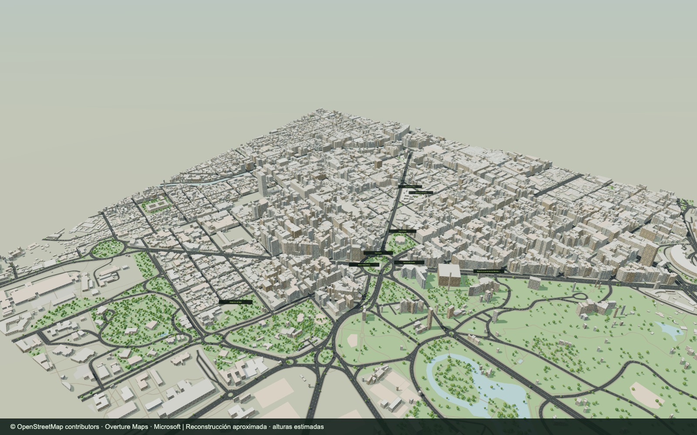

# Nueva Córdoba PyBullet

[](https://colab.research.google.com/github/matiask400/nueva-cordoba-pybullet/blob/main/Mapa_Nueva_Cordoba_Colab.ipynb)

Repositorio: https://github.com/matiask400/nueva-cordoba-pybullet

Escenario urbano configurable para probar drones en **Nueva Córdoba, Argentina**, con geometría a escala real, colisiones, sensores, viento y vehículos físicos. Incluye visor 3D y notebook de Google Colab.

**Acceso:** repositorio público.

**Estado:** escenario de simulación; no incluye pesos de una DQN ni demuestra navegación autónoma. Las alturas y muchas decoraciones son estimadas. El detalle técnico y las limitaciones están en [LEEME.md](LEEME.md).



## Usarlo en Google Colab — paso a paso

1. Descargá este repositorio desde **Code → Download ZIP**.
2. Entrá a [Google Colab](https://colab.research.google.com/).
3. Tocá **Abrir en Colab** arriba cuando el repositorio tenga estos archivos, o elegí **Archivo → Subir notebook** y abrí `Mapa_Nueva_Cordoba_Colab.ipynb`, que está dentro del ZIP extraído. También podés abrirlo desde la pestaña **GitHub** de Colab pegando la URL de tu repositorio.
4. Ejecutá la primera celda para instalar las dependencias. **CPU alcanza; no hace falta GPU.**
5. Ejecutá la celda de archivos y subí el **ZIP completo del repositorio**, sin necesidad de subir cada archivo por separado.
6. En la celda de configuración, activá o desactivá viento, autos, colisión de árboles, ruido y latencia. Elegí el radio de física activa; **160 m** es un buen punto de partida.
7. Ejecutá las celdas restantes: cargan el escenario, verifican el tamaño del CF2X, prueban un contacto contra un techo y muestran el mapa y los sensores.

La demostración deja caer el dron sobre un techo para comprobar la física: **no ejecuta una DQN ni es un vuelo autónomo**. Para usar el agente del equipo, conecten este escenario a su notebook actual según el bloque siguiente.

## Conectarlo al notebook del equipo

1. Cargar el mapa y sus opciones después de crear/reiniciar el cliente PyBullet:

```python
from fisica_urbana import configuracion, crear_escenario
cfg = configuracion()
mapa, mundo = crear_escenario(env.CLIENT, cfg)
ids_obstaculos = mapa['ids_obstaculos'] + mundo.ids_vehiculos
```

2. Reemplazar la generación de edificios artificiales por esa carga. Hacerlo después de cada `resetSimulation`; los IDs anteriores dejan de servir.
3. En el método `_physics` de la clase del entorno, llamar a `mundo.aplicar(1 / self.PYB_FREQ, dron_id)` **en cada subpaso físico**, después de las fuerzas de los motores. No agregar otro `stepSimulation` fuera de `env.step`.
4. Usar `ids_obstaculos` para rayos y choques. Aplicar `mundo.degradar_sensores(lecturas, alcance)` una vez por paso de control si se desea ruido/latencia.
5. Definir inicio y objetivo libres, límites, duración y observaciones antes de cargar el checkpoint. Los modelos del equipo no necesariamente generalizan a la nueva escala.

El mapa conserva metros reales. El dron CF2X usa masa de **27 g**, radio de colisión de **6 cm** y altura de **2,5 cm**, como en los notebooks del proyecto.

## Opciones

| Opción | Configuración |
|---|---|
| Viento y ráfagas aleatorias | `viento.activo`, velocidad, dirección, intensidad y semilla |
| Más viento con la altura | `viento.exponente_altura` y altura de referencia |
| Autos con masa, ruedas y colisión | `vehiculos.activos`, cantidad y velocidad |
| Colisión del arbolado ilustrativo | `arboles.colisiones` |
| Ruido y latencia | `sensores.ruido_sigma_m`, `sensores.latencia_ms` |
| Sector activo / ciudad completa | `sector.radio_m`, `sector.centro_m`, `sector.cargar_todo` |
| Noche, sombras, vegetación y tránsito visual | sección `visual` |

**Los efectos físicos están apagados por defecto.** El visor tiene un botón ⚙ para editar y guardar `configuracion.json`. Los cambios físicos se aplican al iniciar/reiniciar PyBullet. Los autos que se ven en el visor son decorativos; los autos físicos se crean en PyBullet.

## Ver el mapa 3D

Abrí `index.html` en un navegador con WebGL. Para guardar la configuración directamente en la carpeta, ejecutá:

```bash
python3 abrir_visor.py
```

Abrí la dirección que aparece. Arrastrar: orbitar; rueda: acercar; W/A/S/D: mover; Q/E: altura; H: ocultar interfaz. La cámara no tiene colisión. El botón **Recorrido** mueve la cámara, no un agente entrenado.

## Contenido

- **7.938 huellas o partes** en el escenario; **2.690** intersectan el perímetro barrial. No es un conteo verificado de edificios independientes.
- Edificios y patios, calles, parques y ocho hitos de referencia.
- `ciudad_pybullet.py`: carga de colisiones y sensores.
- `fisica_urbana.py`: viento, autos y degradación de sensores.
- `configuracion.json`: opciones compartidas con el visor y el notebook.
- `edificios.geojson` y `nueva_cordoba_lod1.glb`: geometría para GIS y Blender.
- `cobertura.json`, `cobertura_cartografica.png` y `resultado_ciudad.json`: cobertura y validación disponible.

## Validación

Prueba del motor en Kaggle: **OK**. Se verificaron rayos a techos y fachadas y contactos con el CF2X en 7.938 partes; la dinámica se comprobó en un sector de 160 m con 174 partes. Se verificaron apoyo del dron, viento con altura y ráfagas, reproducibilidad, dos autos de 1.000 kg y ruido/latencia de sensores. Resultado detallado: [resultado_ciudad.json](resultado_ciudad.json). Las celdas computacionales del notebook de Colab también se ejecutaron correctamente en Kaggle: 146 construcciones, CF2X de 27 g, 4 contactos y 8 sensores. La selección interactiva del ZIP debe realizarla el usuario en Colab; no fue automatizada. Ver [resultado_colab.json](resultado_colab.json).

Repetir desde la carpeta del proyecto: `python tests/verificar_escenario.py`. La prueba tarda más en instalar dependencias si PyBullet necesita compilarse. La navegación DQN no forma parte de esta validación.

## Límites del escenario

Es una reconstrucción aproximada con datos OSM, Overture y Microsoft. La mayoría de las alturas son estimaciones; terreno plano; vehículos, arbolado y fachadas simplificados. No están relevados todos los cables, postes, balcones, pendientes o interiores. La auditoría automática no sustituye una revisión de cada edificio.

La prueba dinámica usa un **sector** para mantener el costo de simulación acotado. Cargar toda la ciudad con colisiones convexas puede ser lento. Para probar un nanodron a unos 0,25 m/s no es necesario activar físicamente miles de construcciones lejanas.

## Licencias

**Código: [MIT](LICENSE). Datos geográficos consolidados: [ODbL 1.0 y atribuciones](DATA_LICENSE.md).** Los recursos de terceros conservan sus licencias en [THIRD_PARTY_NOTICES.md](THIRD_PARTY_NOTICES.md).

## Compartir y usar en equipo

El repositorio es **público**. El equipo puede abrir el botón de Colab y descargar los archivos sin solicitar acceso a GitHub. No hacen falta tokens dentro del notebook.

1. Descargar **Code → Download ZIP** desde GitHub.
2. Abrir `Mapa_Nueva_Cordoba_Colab.ipynb` en Colab.
3. Ejecutar instalación, subir el ZIP completo y elegir la configuración.
4. Ejecutar la prueba del escenario; después integrar el agente según las instrucciones anteriores.
